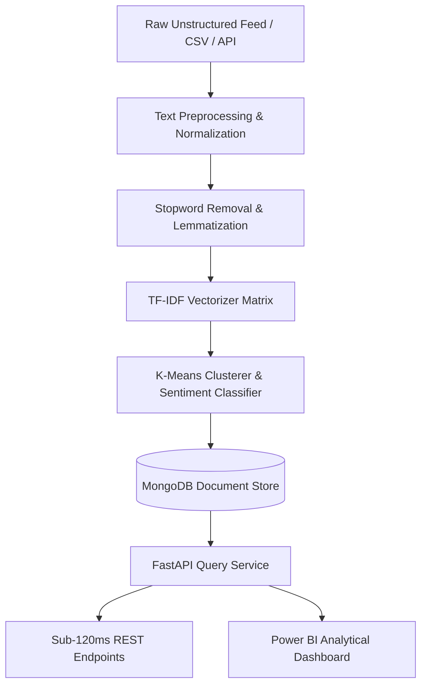

# Engineering Case Studies & System Architectures
**Author:** Chokkarapu Manideep | [GitHub: manideep-4116](https://github.com/manideep-4116)

---

## Case Study 1: High-Throughput NLP Sentiment Engine & REST API
### 1. Problem Statement
E-commerce review feeds generate over 25,000+ unstructured, noisy customer text feedback entries monthly. Manual analysis created a 4-week backlog, impeding timely product defect escalation and feedback auditing.

### 2. Solution Architecture
Designed an asynchronous Python NLP extraction pipeline paired with a high-concurrency FastAPI service and MongoDB document store.

### 3. Key Technical Decisions
- **TF-IDF + Clustering over Dense Transformers:** Minimized computational overhead for high-throughput batch classification, achieving **89% classification accuracy** without requiring expensive GPU compute.
- **MongoDB NoSQL Layer:** Accommodated variable metadata schemas across product categories while sustaining sub-120ms retrieval for compound filter queries.
- **Automated Testing Suite:** Implemented **PyTest** test suites achieving **88% code coverage** across regex tokenizers, edge case handling, and API serialization.

### 4. Measurable Engineering Impact
- **89%** sentiment classification precision on noisy textual inputs.
- **< 120ms** end-to-end API response latency on multi-record payloads.
- **40+ hours/month** saved in manual audit cycles.

---

## Case Study 2: EV Station Load Forecasting & Dispatch Optimization Engine
### 1. Problem Statement
Commercial electric vehicle (EV) charging networks experienced severe queue bottlenecks during unpredicted peak hours, stressing local grid substations and causing customer churn.

### 2. Solution Architecture
Constructed a time-series predictive modeling engine trained on 100,000+ historical transaction records, integrated with an indexed relational PostgreSQL database.

### 3. Database & System Optimizations
- **Relational Schema Indexing:** Created composite B-tree indices on `(station_id, charging_start_timestamp)`, reducing analytical query scan times by **42%**.
- **Outlier Sanitation:** Implemented statistical interquartile range (IQR) filters in Python/Pandas to eliminate erroneous sensor spikes and network dropout records.
- **Forecasting Algorithm:** Multi-variable regression incorporating temperature, time-of-day, day-of-week, and localized historical demand velocity.

### 4. Measurable Engineering Impact
- **91.8%** demand forecasting accuracy (margin of error limited to **6.2%**).
- **42%** acceleration in analytical SQL query runtimes.
- **18%** reduction in projected station queue bottlenecks via dynamic load balancing recommendations.
